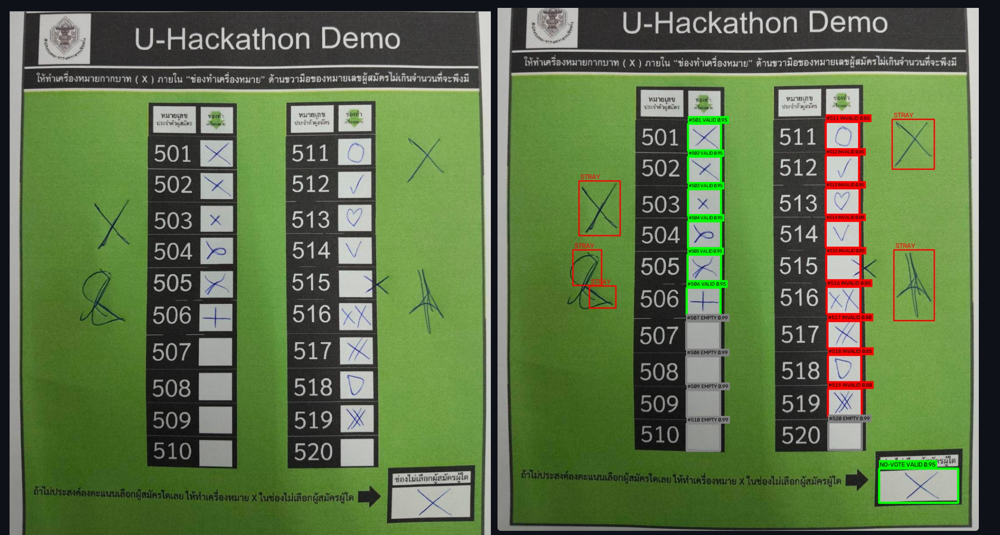
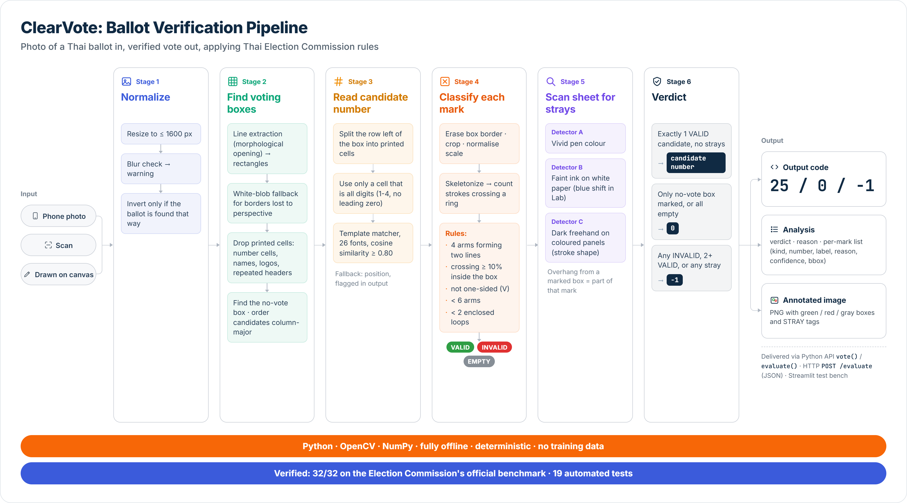

# Thai Ballot Verification Engine

Offline OpenCV pipeline that reads a photo or scan of a Thai election ballot (or the EC "บัตรดี / บัตรเสีย" test grid). It finds the voting boxes, classifies each one as `VALID` / `INVALID` / `EMPTY`, flags stray ink outside the boxes, and gives a ruling: **บัตรดี** (with the number voted for), **บัตรเสีย**, or **บัตรไม่ประสงค์ลงคะแนน**.



## Quick start

```bash
pip install -r requirements.txt
streamlit run app.py      # test bench at http://localhost:8501
pytest -q                 # 32-box benchmark + synthetic ballots
```

## Web app integration (HTTP endpoint)

Use this when the web app isn't Python (e.g. a JavaScript front end or Node back end). It needs no extra dependencies beyond `requirements.txt`.

```bash
git clone https://github.com/VecetyP/U-Hackathon-Demo-ClearVote.git
cd U-Hackathon-Demo-ClearVote
pip install -r requirements.txt
python server.py                    # http://127.0.0.1:8000  (add --host 0.0.0.0 to reach it from other machines)
```

**`POST /evaluate`**: send the ballot image, either as `multipart/form-data` (any file field) or as raw PNG/JPEG bytes. The optional `?first_number=N` is only used when a printed number can't be read. The response is the same object as `ballot.evaluate()`, with the picture base64-encoded:

```json
{
  "output": 25,
  "analysis": {
    "verdict": "valid", "verdict_th": "บัตรดี",
    "reason": "single valid cross in box #25",
    "marks": [{"kind": "candidate_box", "number": 25, "number_source": "printed", "label": "VALID",
               "reason": "single cross inside box", "confidence": 0.95, "bbox": [829, 689, 184, 113]}],
    "boxes_detected": 7, "warnings": [],
    "image": "iVBORw0KGgo..."
  }
}
```

Other responses: `400 {"error": ...}` if the body isn't an image, `413` above 20 MB, and `GET /health` returns `{"ok": true}`. CORS is open, so a browser page on another origin can call it directly.

```js
const form = new FormData();
form.append("image", fileInput.files[0]);                 // or a canvas.toBlob(...) result
const res = await fetch("http://127.0.0.1:8000/evaluate", { method: "POST", body: form });
const { output, analysis } = await res.json();
// output: printed number / 0 (no-vote) / -1 (invalid)
imgEl.src = "data:image/png;base64," + analysis.image;   // analyzed picture
analysis.marks.forEach(m => console.log(m.kind, m.number, m.label, m.reason));
```

```bash
curl -F "image=@ballot.png" http://127.0.0.1:8000/evaluate
```

**Staying up to date:** the API shape above is kept backward compatible, so new fields may be added but existing ones won't be renamed or removed. To pick up pipeline improvements, run `git pull` and restart `python server.py`.

The server has no authentication. It binds to localhost by default; put it behind your app's backend or a reverse proxy before exposing it publicly.

## Integration: one number per ballot (Python)

```python
import cv2, ballot
code = ballot.vote(cv2.imread("ballot.png"))   # or cv2.imdecode(bytes, cv2.IMREAD_COLOR)
```

| Ballot | `vote()` returns |
|---|---|
| Valid, one candidate marked | that candidate's **printed number** (e.g. `25`) |
| Valid, chose not to vote (no-vote box marked, or every box empty) | `0` |
| Invalid (บัตรเสีย) or no ballot found | `-1` |

Need the details too? `ballot.evaluate(img)` returns everything in one object:

```python
obj = ballot.evaluate(img)
obj["output"]                      # main result: number / 0 / -1 (same as vote())
obj["analysis"]["verdict"]         # "valid" | "invalid" | "no_vote" | "no_ballot"  (verdict_th: บัตรดี / บัตรเสีย / ...)
obj["analysis"]["reason"]          # e.g. "2 boxes marked (box #3, box #12); 1 stray mark(s) outside the boxes"
obj["analysis"]["marks"]           # one entry per mark found (empty boxes left out):
#   {"kind": "candidate_box" | "no_vote_box" | "stray", "number": 25, "number_source": "printed" | "position",
#    "label": "VALID" | "INVALID", "reason": "single cross inside box", "confidence": 0.95, "bbox": [x, y, w, h]}
obj["analysis"]["image"]           # analyzed picture (colored boxes + labels) as raw PNG bytes
obj["analysis"]["boxes_detected"], obj["analysis"]["warnings"]
```

`bbox` values are pixel coordinates in the analyzed picture. Images larger than 1600 px on their longest side are scaled down first, so for big photos the coordinates are in the scaled picture, not the original. Everything except `image` is JSON-ready; base64-encode the PNG if you need to send it as JSON.

From the command line: `python ballot.py ballot.png` prints the main code. `ballot.analyze(img)` returns the full result (`output`, `verdict`, per-box labels, strays, overlay image) when you need more than the code.

The candidate number is **read from the print** in the cells left of the X box. A ballot may have up to two cells there, a number cell and a name cell, in either order. They can sit flush against the box or with a gap, and the number can be dark-on-light or light-on-dark. The row is split into printed cells at their border lines. A cell counts as the number cell only if everything printed in it is a confident digit (1–4 digits, no leading zero), so letters in a name that look like digits (B~8, O~0, l~1) are never used. Reading uses an offline digit matcher with templates from common fonts (`digits.npz`, built by `ballot.build_digit_templates()`), so there's no OCR dependency. If no number can be read, it falls back to position (column-major from *First candidate number*), and the app warns you.

## Test bench

The app opens on **Draw on ballot**: the blank EC ballot (`tests/assets/samplevoteFlat.png`) is shown as a canvas. Upload your own (custom) ballot there to draw on it instead. Draw marks with the mouse, press **Analyze** to run them through the pipeline, and use **Undo** / **Clear** to start over. The canvas is a small built-in component in `canvas/index.html`, so there's nothing extra to install. The second tab has file upload, the one-click benchmark and the sample ballots.

## How it works (`ballot.py`)



A photo, scan or canvas drawing goes through six stages. It's all classical computer vision with Python, OpenCV and NumPy: no neural network, no training data, no cloud. The same image always gives the same answer, and every decision comes with a reason.

### 1. Normalize
- Downscale to at most 1600 px on the longest side, and warn if the image looks blurry.
- Treat the image as a negative (white print on black) only if the ballot is actually found that way. A phone photo with a dark surround is as dark on average as a true negative, so brightness alone can't decide.

### 2. Find voting boxes
- **Line extraction:** keep long horizontal and vertical strokes (morphological opening) and trace the rectangles they form. A rectangle counts as a box when its size is plausible and its inside is mostly blank paper. Pixel positions are never hard-coded, so scale, tilt and margins can vary.
- **White-blob fallback:** a box whose border is lost to perspective or shadow (for example a bottom row flush with a dark column) is still found as a white rectangle.
- **Drop printed cells** that look like boxes:
  - filled number cells, because their inside isn't blank;
  - logo and name cells flush against the box, because the mark box is the rightmost cell of its row;
  - name/number label columns, because a voter marks one box, not most of them;
  - column headers ("หมายเลขประจำตัวผู้สมัคร", "ช่องทำเครื่องหมาย"), because their print repeats across columns.
- **No-vote box** (ไม่ประสงค์เลือกผู้สมัครผู้ใด): the box in a column of its own (bottom right on EC 2569 ballots) or set apart below the grid. If its frame holds a label strip and a mark area, the mark area is used.
- Candidate boxes are ordered column-major.

### 3. Read candidate number
- Split the row to the left of the box into printed cells at their border lines. A row may hold a number cell, or a number cell and a name cell in either order, flush or with gaps.
- Use only a cell where everything printed is a confident digit: 1 to 4 digits, no leading zero. A name never contributes, even when its letters look like digits (B~8, O~0, l~1).
- Digits are matched against templates from 26 fonts (`digits.npz`) by cosine similarity, at least 0.80. There's no OCR dependency.
- If no number can be read, the box is numbered by position from *First candidate number*, and the output marks it `number_source: "position"`.

### 4. Classify each mark
- Erase the box's printed border, crop the box with a margin, and rescale it to a standard size (at most 1.8:1, so an X across a wide box is as steep as in a candidate box).
- Skeletonize the ink and, for every skeleton point, count how many strokes cross a small ring around it. Four strokes meeting means a crossing.
- **VALID** needs all of these:
  - 4 arms leave the crossing and form **two straight lines** (opposite arms line up);
  - the **crossing point is at least 10% inside the box**. Strokes may run past the border, and that overhang belongs to the mark. A cross drawn on the border line itself is outside;
  - the ink is not all on one side of the crossing, which would make it a narrow V;
  - fewer than 6 arms (more means an overlapping double cross);
  - fewer than 2 enclosed loops (more means a star).
- Everything else is **INVALID**: ✓ V ^ / ○ □ ♡ ·, double crosses, crossed-out attempts, crosses with extra writing, and crosses outside the box. A box with no ink is **EMPTY**.

### 5. Scan the sheet for strays
Any ink on the ballot outside the boxes voids it. Three independent detectors look for it:
- **A. Vivid pen colour**, for digital pens and bright blue ink, anywhere on the sheet.
- **B. Faint ink on white paper.** It's darker than the paper around it and shifted toward blue in Lab colour space; black print isn't.
- **C. Dark freehand marks on coloured panels.** Translucent blue-black ink photographs almost neutral on green or pink, so it's told apart from print by shape: pen-width strokes, at least about half a box in size, enclosing paper rather than solid, and not part of the box grid, the large dark print or a long printed line.

Ink that continues out of a marked box (a stroke running past the border) is part of that mark, not a stray.

### 6. Verdict

| Result | Rule | `output` |
|---|---|---|
| **บัตรดี** (valid) | exactly one VALID candidate box, no stray marks | candidate number |
| **บัตรไม่ประสงค์ลงคะแนน** (no vote) | only the no-vote box is marked, or every box is empty | `0` |
| **บัตรเสีย** (invalid) | any INVALID box, two or more VALID boxes, or any stray mark | `-1` |

The result comes back as the output code, an analysis (verdict, reason and a per-mark list) and an annotated image. You can get it through `vote()` / `evaluate()` in Python, `POST /evaluate` over HTTP, or the Streamlit test bench.

Every threshold is a named constant in `ballot.py`; tune them there. The pipeline scores 32/32 on the Election Commission's official benchmark and is covered by 19 automated tests (`pytest -q`).

## Known limits

- The digit matcher is tuned for printed sans/serif fonts, Thai UI fonts and OpenCV fonts. On randomized custom ballots (number / name / box in any order, names full of digit-like letters, Thai names) it read about 98% of numbers and never read a wrong one; unread rows fall back to position-based numbering. Decorative or handwritten numbers also fall back.
- A cross needs two strokes that clearly intersect: crossings sharper than about 45°, especially with a thick pen in a small box (phone photos), can be read as invalid. A "V" with a stroke through it at a gentle angle can still pass as a cross. Measured on randomized marks; see the stress numbers in the git history.
- Stray marks drawn over dark print (the title band, the black number columns) are mostly missed, since dark ink on black barely shows. Marks smaller than about half a box on coloured panels, and black-pen marks on white paper, are also missed. A diff against a blank ballot would close these gaps.
- On simulated ballpoint doodles, the detectors catch roughly 95% on white paper and 55–100% on coloured panels, depending on the photo. A photo of a screen is the weakest case. There are zero false strays on all clean test ballots.
- Torn or folded ballots are not detected beyond the "no boxes found" and "blurry" warnings.
